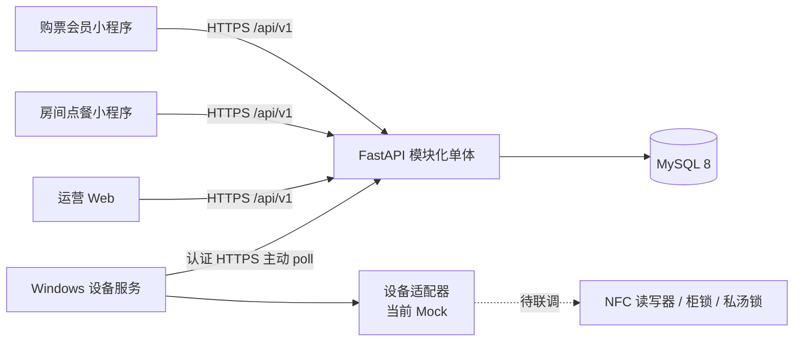
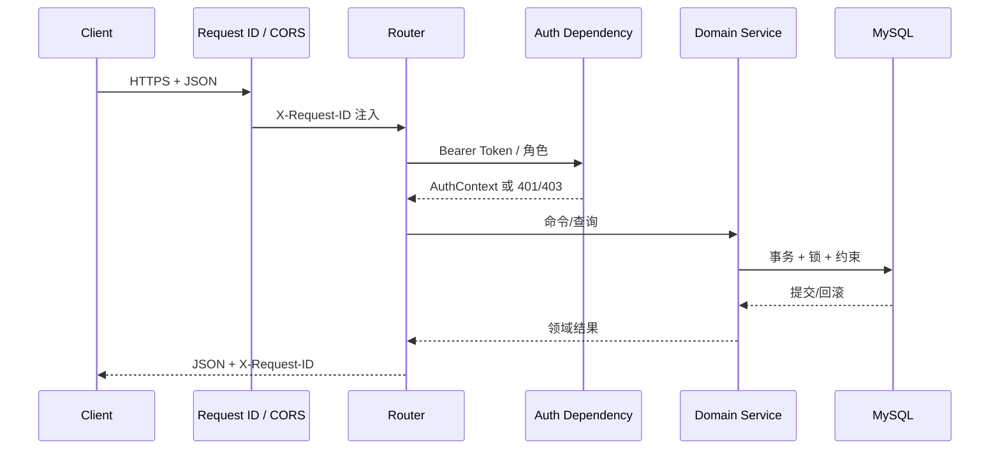
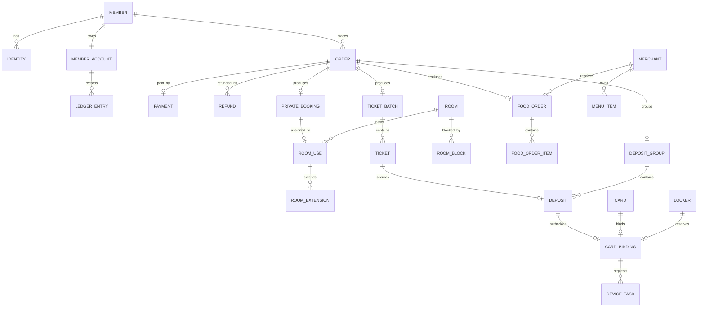
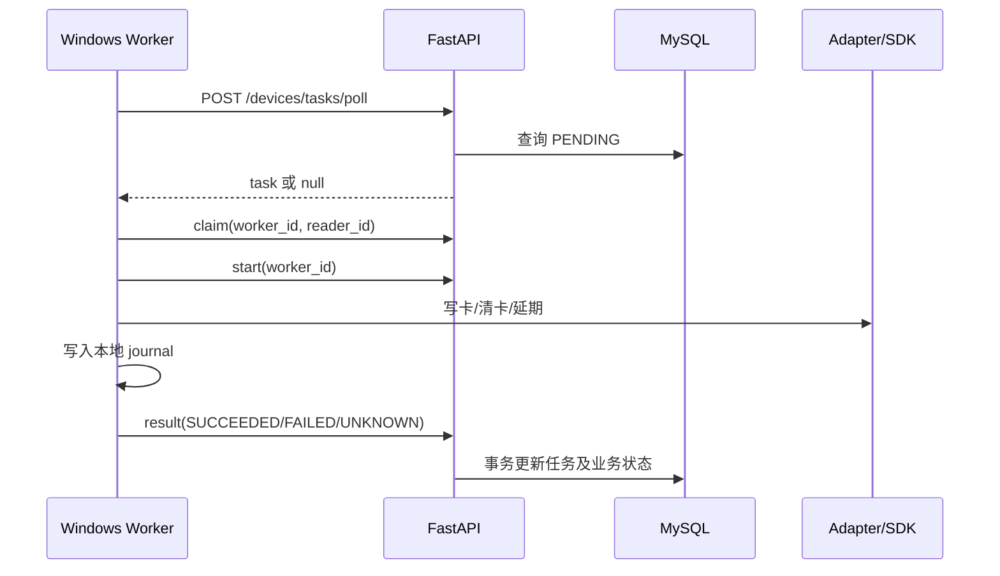

# 蜀南温泉一期后端系统架构规范

> 文档版本：1.0  
> 适用范围：`backend/`、`device_service/` 与相关 MySQL 数据结构  
> 依据：当前仓库实际代码、Alembic 初始迁移、测试与 [`backend-api.md`](./backend-api.md)  
> 状态说明：**已实现**为当前代码可运行能力；**开发模拟**仅用于联调；**待确认/未实现**不得当作生产能力。

## 1. 目标与边界

### 1.1 架构目标

1. 以唯一 `member_id` 统一购票会员端和独立点餐端的会员身份与储值账本。
2. 以服务端作为价格、库存、余额、订单状态、押金责任和设备授权的唯一事实来源。
3. 用数据库事务、唯一约束、行锁和业务唯一号防止超卖、重复扣款、重复发牌和重复退款。
4. 将快速变化的支付、微信身份和硬件能力隔离在可替换适配器之后；在能力未验证时明确返回“不支持/未配置”。
5. 一期保持模块化单体，降低部署与事务复杂度；不提前拆分微服务。

### 1.2 一期不做

- 不做闸机接入、自动核票或离园统一清账。
- 不做手牌场内消费挂账、消费押金抵扣和自动退余额。
- 不接商家现有 POS/收银系统。
- 不把微信小程序插件文档视为 Windows DLL 或 HTTP 设备 API 证明。
- 不实现自动退款政策，点餐/加钟等争议场景必须人工处理。

## 2. 技术栈与运行拓扑

| 层 | 技术 |
|---|---|
| API | Python 3.12、FastAPI、Pydantic、SQLAlchemy 2 |
| 数据库 | MySQL 8（生产目标）；SQLite 用于快速领域/API 测试 |
| 迁移 | Alembic |
| 测试 | pytest、FastAPI TestClient；MySQL 并发测试单独标记 `mysql` |
| Web | Vue 3 + TypeScript + Vite + Pinia |
| 小程序 | uni-app + Vue 3，编译目标 `mp-weixin` |
| 设备服务 | Python 出站 Worker，当前提供 MockAdapter |



- Web 不直接访问 USB、DLL、NFC 或园区私有端口。
- 云端不主动连接园区内网；设备服务主动领取任务并回传结果。
- 生产部署位置、域名、证书、网络拓扑**待确认**。

## 3. 逻辑分层与目录

```text
backend/
├─ alembic/                  # 数据库迁移
├─ app/
│  ├─ main.py                # 应用工厂、生命周期、开发种子
│  ├─ api.py                 # 路由总装配
│  ├─ models.py              # 迁移/建表聚合模型入口
│  ├─ core/                  # 配置、鉴权、数据库、错误
│  └─ modules/
│     ├─ identity/           # 会员与登录标识映射
│     ├─ catalog/            # 票价、充值活动、业务配置
│     ├─ wallet/             # 本金/赠送账本
│     ├─ payments/           # 订单、支付、退款、审计事件
│     ├─ tickets/            # 门票批次、逐人票、入园
│     ├─ rooms/              # 私汤预约、库存、分房、清洁、加钟
│     ├─ dining/             # 商家、菜单、房间码、点餐履约
│     ├─ access/             # 押金、手牌、柜位、绑定
│     ├─ devices/            # 设备任务状态机
│     ├─ operations/         # 前台/财务/管理员运营 API
│     └─ audit.py / common.py / seed.py
└─ tests/                    # 领域、API、MySQL 并发测试
```

分层职责：

1. **Router**：解析路径/请求体、鉴权、角色校验、调用领域服务、组装响应。
2. **Domain Service**：执行业务不变量、状态转换、加锁、幂等和跨模块协作。
3. **Model**：持久化字段与关系；不在模型层隐藏业务审批规则。
4. **Core**：统一配置、会话、错误信封、请求号、Bearer 鉴权。
5. **Device Worker**：只负责领取任务、调用适配器、回传结果和本地 journal 补偿。

## 4. 模块边界与依赖规则

| 模块 | 拥有的数据/职责 | 可调用关系 |
|---|---|---|
| identity | `members`、`member_identities` | 被所有登录上下文依赖；不得静默合并会员 |
| catalog | `ticket_price_rules`、`recharge_activities`、`business_configs` | 被票务、私汤、充值读取 |
| wallet | `member_accounts`、`ledger_entries` | 支付/退款调用；流水只追加 |
| payments | `orders`、`payments`、`refunds`、`audit_events` | 支付分派调用票务、房间、点餐、押金、加钟 |
| orders | 会员订单查询、订单详情、发起支付 | 读取支付域的订单事实；不自建第二套订单状态 |
| tickets | 门票批次与逐人票 | 支付成功后出票；前台显式入园 |
| rooms | 预约、房间、使用、清洁、占用、加钟 | 预约/分房/加钟/设备任务协作 |
| dining | 商家、商品、房间码、点餐订单与履约 | 支付后入队；商家更新履约 |
| access | 押金组/逐枚押金、手牌、柜位、绑定 | 发卡/归还/退款/设备任务 |
| devices | 设备任务状态 | 被 access/rooms 创建；不直接决定柜门实际状态 |
| operations | 运营查询与人工动作 | 通过各领域服务/受控状态变更执行 |

规则：

- 跨模块写操作必须由服务层组合，不允许路由直接跨表改写多个领域状态。
- 支付状态只由 `PaymentService` 确认；业务模块通过 `_dispatch` 分派。
- 退款必须保留原支付与原本金/赠送扣款依据，不允许“新建一笔交易”掩盖失败。
- 审核、改价、退款、强制操作均写审计事件。

## 5. 请求处理链与鉴权



### 5.1 鉴权

- Bearer Token，角色：`member/frontdesk/merchant/finance/admin/device`。
- 当前 `_token_context` 只在 `APP_ENV != production` 且 `DEV_AUTH_ENABLED=true` 时接受静态开发令牌。
- 生产环境无条件拒绝开发令牌，即使误留 `DEV_AUTH_ENABLED=true`。
- 正式微信登录、OpenID/UnionID 映射、会话颁发**尚未实现**。
- 会员资源按 `auth.member_id` 校验归属；角色不是充分条件。

### 5.2 错误规范

统一：

```json
{"code":"ORDER_NOT_PAYABLE","message":"Order is not pending payment","request_id":"req-123"}
```

- `ApiError` 映射业务 4xx。
- Pydantic 校验错误统一 `422 VALIDATION_ERROR`。
- 未捕获 500 不回传堆栈；以 `request_id` 关联服务日志。
- 响应包含 `X-Request-ID`；调用方可提供合法请求号。

## 6. 数据架构

### 6.1 数据域



权威事实：

- 金额一律整数分；成交时保存价格快照。
- 会员可见余额 = 本金 + 赠送金；后台可按本金/赠送分别核对。
- 票券、预约、点餐、押金和加钟各有独立业务实体。
- 房间号只在内部库存/前台分房使用，不承诺给创建预约的游客。

### 6.2 迁移与约束

- 所有表结构变更必须新增 Alembic revision，禁止生产直接 `create_all`。
- 关键唯一约束：登录标识 `(appid, openid)`、订单号、支付号、退款号、设备任务幂等键、账本 `(member_id, entry_type, reference)`。
- 开发环境启动自动建表并写演示种子；生产不自动建表、不自动种子。
- MySQL 外键、唯一键和行锁是最终防线，不能只依靠前端按钮或 Redis 锁。

## 7. 核心业务不变量

### 7.1 票券

- 每位实际游客一张独立票；多人订单逐人出票。
- 每票只能成功入园一次；入园必须由前台显式提交幂等 `request_id`。
- 设备写卡/读回成功不自动耗票，防止选错卡造成误核销。
- 票价按参观日期由服务端规则决定。

### 7.2 私汤库存

- 17 间房、五个固定 120 分钟场次，末场后清洁 30 分钟。
- 多场次必须相邻；必须由同一间具体房间覆盖“使用总区间 + 最终清洁区间”。
- 待支付预占 15 分钟；支付确认后才确认预约。
- 可售量不能简单等于 17；需排除维修、人工占用、已售、实际未结束使用和加钟冲突。
- 实际分房从到店时间起算完整时长；晚到要重新检查后续预约，冲突不得覆盖。
- 房态：空闲/使用中/待清洁/清洁中/维护；未清洁完成不得再分房。

### 7.3 点餐

- 房间码/房间号只定位送餐地址，不证明访客在场，不授予会员余额权限。
- 创建订单要求有效 `room_use_id`，支付完成再次校验同一使用记录。
- 一个订单只能属于一个营业商家；停用商家不能接收新订单。
- 支付且可送达才进入商家队列；不可送达进入异常，不自动退款。
- 履约顺序固定：待接单 → 已接单 → 制作中 → 已送达。

### 7.4 储值账本

- 消费先扣本金，本金不足再扣赠送金。
- 账本追加式记录，不覆盖原记录。
- 退款按原订单实际本金/赠送扣减量分别冲回。
- 充值、门票、私汤、点餐、手牌押金、加钟分别记账。
- 充值和押金只能微信支付；不自动退余额或提现。

### 7.5 手牌与押金

- 每枚手牌独立押金责任和退款单；可一人代付多枚。
- 未支付押金不能发牌；先预占空柜，再创建写卡任务。
- 写卡结果未知不释放柜位、不自动重试、不重新分配。
- 归还实物与清卡分离；清卡失败不阻断应退押金，但卡片隔离。
- 已收押金未发牌可走押金退款，不能遗留无手牌押金责任。

### 7.6 设备任务

状态机：

```text
PENDING → CLAIMED → RUNNING → SUCCEEDED | FAILED | UNKNOWN
```

- 只有领取任务的 worker 能开始和回传。
- 终态不可被不同结果覆盖；重复相同结果幂等。
- `UNKNOWN` 表示“可能已写卡但结果未确认”，必须人工核实实体权限。
- 写卡成功不等同于门已打开；除非厂商提供可信门磁事件。
- 本地服务只重试“结果上报 HTTP”，不重试设备写卡。

## 8. 事务、并发与幂等

| 风险 | 控制 |
|---|---|
| 私汤并发超卖 | 事务内按单房检查完整区间；候选房加行锁 |
| 15 分钟预占与支付竞争 | 锁定预约/订单，支付确认检查有效期与状态 |
| 重复支付回调 | 支付号唯一，已 SUCCESS 直接返回，不重复分派 |
| 重复入园 | `request_id`/票状态事务校验 |
| 双人抢柜 | 先锁定并预占空柜，再建写卡任务 |
| 重复退款 | 固定业务退款号；每枚押金最多成功一次 |
| 重复设备结果 | 任务终态比较；冲突返回 409 |
| 点餐换客误送 | 创建绑定 `room_use_id`，支付时再次校验 |
| 乱序写账 | 账本行锁 + 追加记录 + 唯一业务引用 |

约定：

1. 金额计算、状态转换和库存检查在服务端事务内完成。
2. 客户端重试必须复用原业务号/请求号。
3. 超时或未知结果不自动判失败，进入人工异常或待查询状态。
4. MySQL 并发测试已编写，但当前环境未执行，生产前必须补验。

## 9. API 与版本规范

- 统一前缀 `/api/v1`；正式生产只走 HTTPS。
- 资源使用稳定业务号（`order_no/payment_no/refund_no/task_no`），内部数据库 ID 不暴露为主要查询键。
- 列表接口当前无分页参数，有固定上限；数据增长后必须增加游标/分页。
- 状态值使用稳定英文枚举，前端通过显示映射转中文，不能依赖展示文案做业务判断。
- 金额字段统一 `*_cents`；时间 ISO 8601。
- OpenAPI：`/docs`；变更后更新 `docs/openapi.json`。
- 完整字段与示例见 [`backend-api.md`](./backend-api.md)。

## 10. 设备服务架构



- 凭据、后端地址、worker/reader ID 来自本地安全配置。
- 网络断开时保留待上报结果；恢复后使用同一 task ID 重报。
- 真实 ABI、卡片结构、密钥、扇区、读写回验、断网开锁均**待厂商 SDK 与样机验证**。

## 11. 安全与审计

- 开发令牌不是生产凭据；生产必须接入受控身份服务和会话管理。
- AppSecret、支付私钥、设备密钥只存在服务端/本机安全配置，不进前端、Git 或日志。
- Web API 按角色和数据归属双重校验。
- 退款、房态变更、人工改期、发卡、设备补偿均记录审计：操作人、时间、前后状态、原因、请求号。
- 日志不得保存真实 AppSecret、支付密钥、手牌密钥或完整游客敏感资料。
- CORS 只允许配置的 Web 来源；不假定公网开放。

## 12. 部署、配置与运维

### 12.1 环境

- `development`：允许自动建表、种子、开发鉴权、Mock 支付/退款、Mock 设备。
- `test`：测试数据库隔离，固定短生命周期数据。
- `production`：无自动建表和种子；开发鉴权、Mock 支付、Mock 退款全部禁用。

关键变量：`DATABASE_URL`、`APP_ENV`、`WEB_ORIGIN`、`DEV_AUTH_ENABLED`、`PAYMENT_PROVIDER`、角色开发令牌、`DEVICE_SERVICE_TOKEN`。生产值由密钥管理提供。

### 12.2 部署步骤

1. 创建隔离数据库和最小权限账号。
2. 执行 `alembic upgrade head`。
3. 启动 API，健康检查 `/api/v1/health`。
4. 部署 Web 静态资源，配置 HTTPS 与 CORS。
5. 配置设备服务凭据，仅开放出站 HTTPS。
6. 验证支付、退款、设备适配器后逐个启用，不以 Mock 结果代替验收。

### 12.3 运维关注

待处理退款、微信对账差异、设备 UNKNOWN、设备服务掉线、房间冲突、待清洁超时、支付与订单状态漂移。异常只能展示事实和人工处理入口。

## 13. 测试与质量门槛

| 层级 | 内容 | 当前状态 |
|---|---|---|
| 领域单元/集成 | 账本、票券、房间、点餐、押金、设备 | 通过（SQLite） |
| API | 鉴权、角色、CRUD、幂等、异常 | 通过（SQLite） |
| 数据迁移 | upgrade/downgrade/upgrade、`alembic check` | 通过（SQLite 验证） |
| MySQL 并发 | 超卖、抢柜、支付/预占竞争 | 已编写，当前环境**未执行** |
| 微信真实支付/退款 | 商户号、验签、通知、查询 | **未验证** |
| Windows/NFC/锁具 | SDK、写卡回读、断网、门磁 | **未验证** |
| 浏览器/真机 UI | Web E2E、小程序 WXML/真机 | Web 构建通过；真机未验收 |

上线门槛：

1. 迁移与备份恢复演练通过。
2. MySQL 并发测试通过。
3. 真实支付/退款、订单对账与异常流程有签认记录。
4. 设备联调报告由业务方、设备商共同签认。
5. 业务取消/退款/押金/加钟政策已正式确认。

## 14. 可演进方向

- 增加读模型/报表事实表，不改变交易主表。
- 列表接口增加游标分页和索引审计。
- 对账模块接入微信账单并记录差异责任人。
- 设备适配器独立进程/服务，但不改变“任务出站领取”协议。
- 多门店时引入 `property_id/merchant_scope`，当前一期不做多租户。
- 如果部署位置变化，保持 API/数据库边界与环境配置，不硬编码云端地址。

## 15. 已知限制与待确认

- 正式微信登录、UnionID 绑定和两个 AppID 的关系未确认。
- 微信支付/退款商户能力、部分退款次数与通知验签未实现。
- Windows SDK、NFC 读写器、柜锁和私汤锁真实接口未取得。
- 押金金额、损坏/遗失责任、取消政策、加钟规则、部署拓扑未确认。
- 本期无正式渠道对账、自动退款和离线业务成功。
- 当前 SQLite 测试不能代表 MySQL 生产并发结论。

本规范与代码冲突时，以最新业务签认和实际可验证代码为准；无法验证的能力必须保持“待确认”，不得用 Mock 成功替代生产验收。
